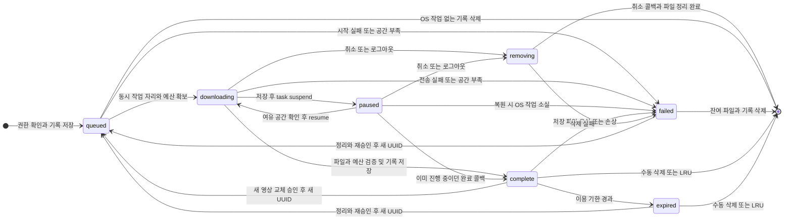

# Download 상태도

`OfflineDownload.State`와 실제 `OfflineDownloadStore`의 전이를 작품 한 건의 관점에서 그렸다. 재다운로드는 이전 시도 재사용이 아니라 새 UUID를 가진 작업이다. 영상 파일 전송과 기록 정리가 끝나기 전에는 삭제 성공으로 표시하지 않는다.

- queued에는 전송 작업이 없다. downloading·paused·removing은 작업 자리와 용량 예약을 유지한다. 일시정지한 두 작업이 있으면 세 번째는 기다린다.
- pause/resume 저장 실패 시 상태를 되돌리며 OS 명령을 진행하지 않는다. DB/저널 저장이 불가능하면 새 전송도 시작하지 않는다.
- 고정 항목과 재생 lease가 있는 파일은 자동 LRU에서 제외한다. 재생 중인 파일의 삭제·교체는 거부한다. 만료 파일은 새 재생이 차단되지만 이미 승인된 재생은 파일을 사용한 뒤 lease를 반환한다.
- 취소는 removing을 먼저 영속화한다. 늦은 완료 콜백이 와도 complete나 완료 알림으로 돌아가지 않는다. 로그아웃은 알림 권한 epoch와 계정 수명을 먼저 무효화한 뒤 파일을 정리한다.
- failed에서 남은 파일이 있으면 정리될 때까지 용량을 계속 반영한다. 실패 기록은 사용자 재시도 또는 삭제 대상으로 남긴다. 제거 실패를 성공으로 감추지 않는다.
- 다운로드 메타데이터는 네이티브 전송 복원용 별도 파일 journal이다. B1의 찜·이어보기·검색 projection/outbox SQLite와 역할을 분리한다.

코드: [상태/예산 모델](../../Packages/StreamLabCore/Sources/StreamLabDomain/Models/OfflineDownload.swift), [네이티브 전송 adapter](../../Packages/StreamLabUI/Sources/StreamLabCatalogFeature/Downloads/OfflineDownloadStore.swift). 검증: OfflineDownloadBudget/Failure/DiskPressure/Expiry 테스트와 [F06·F09 네이티브 복합 실행](../CI_VALIDATION.md).
