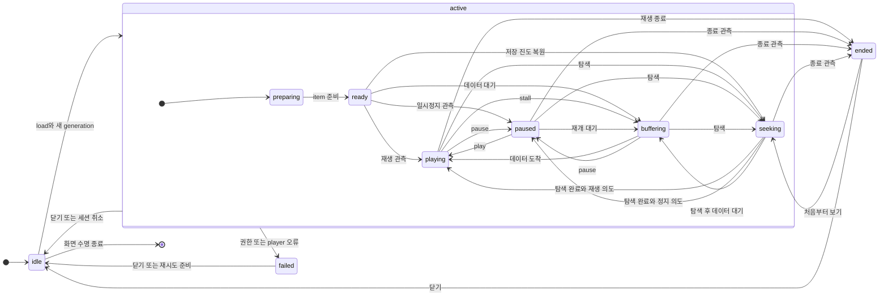

# Player 상태도

`PlaybackDiagnostics.State`의 관측 상태와 `PlaybackModel`의 실행 수명을 구분한다. 아래 active는 설명용 묶음이며 코드의 enum 값이 아니다. 네트워크가 끊겼다는 이유만으로 playing을 failed로 바꾸지 않는다. 버퍼가 남으면 재생을 계속하고 실제 player/권한 오류를 관측할 때 실패로 전이한다.

- `begin()`은 새 시도마다 preparing으로 초기화하고 generation을 바꾼다. 수동 재시도는 기존 실패를 playing으로 건너뛰지 않고 새 권한·새 player 준비를 거친다. 허용 횟수를 넘으면 시도를 만들지 않는다.
- 같은 상태 반복 관측은 허용하지만 도표에는 self loop를 생략했다. 이전 generation/item/seek의 콜백과 역행하는 시각은 무시한다. 허용되지 않은 전이는 상태를 바꾸지 않고 invalidTransitionCount로 남긴다.
- 닫기·프로필 변경·로그아웃은 Task 취소, observer 해제, item 분리, 재생 중지 후 generation을 무효화한다. 멈춘 화면이 늦은 실패·종료 콜백으로 다시 나타나지 않는다.
- ended에서 뒤늦은 실패를 허용하지 않는다. F10의 실패/종료 순서 경합은 먼저 처리된 유효 이벤트와 수명 검사를 따른다.
- 준비 중 취소, 권한 만료·갱신 실패, seek 타임아웃, background/PiP 경계는 `PlaybackSessionLifecycleTests`·`PlaybackEntitlementBoundaryTests`·`PlaybackDiagnosticsTests`로 확인한다. [F01–F10](../CHAOS_ACCEPTANCE.md).

코드: [관측 reducer](../../Packages/StreamLabCore/Sources/StreamLabDomain/Models/PlaybackDiagnostics.swift), [player adapter](../../Packages/StreamLabUI/Sources/StreamLabCatalogFeature/Playback/PlaybackModel.swift).
